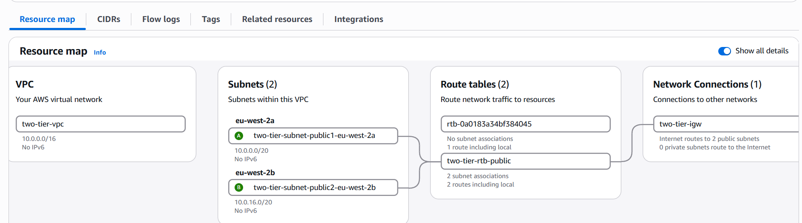
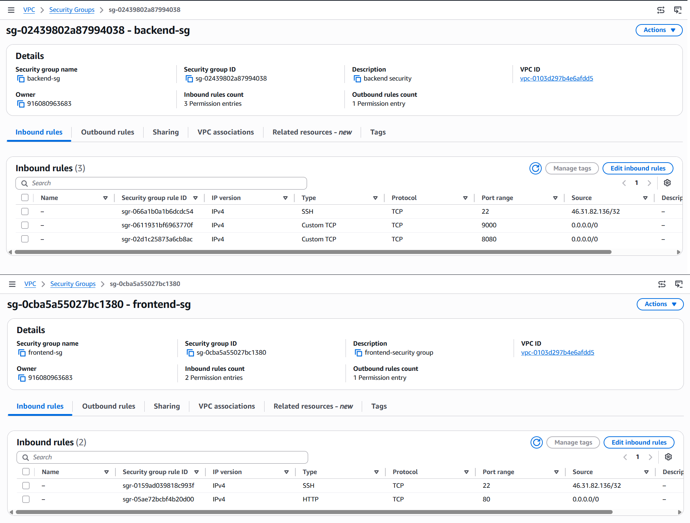
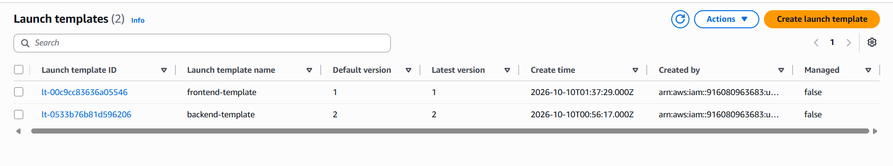
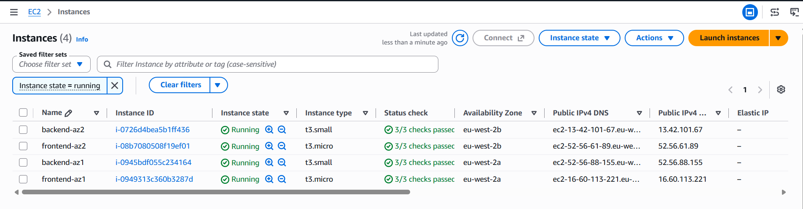
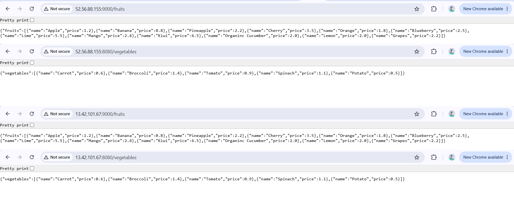
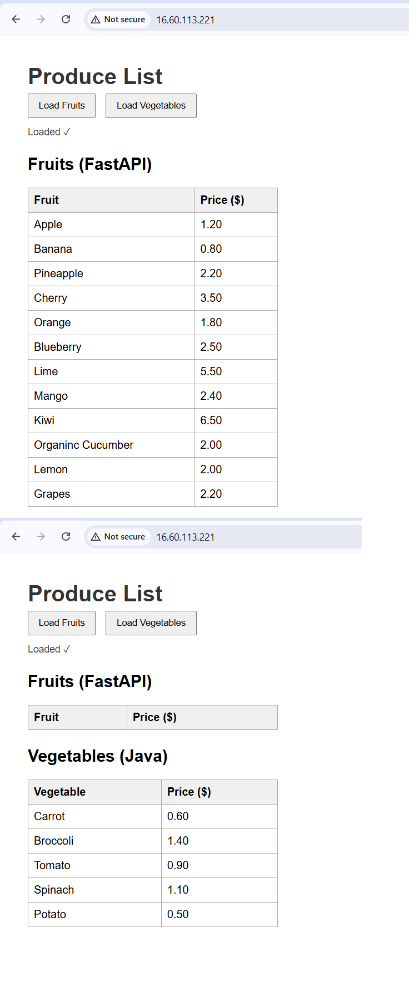
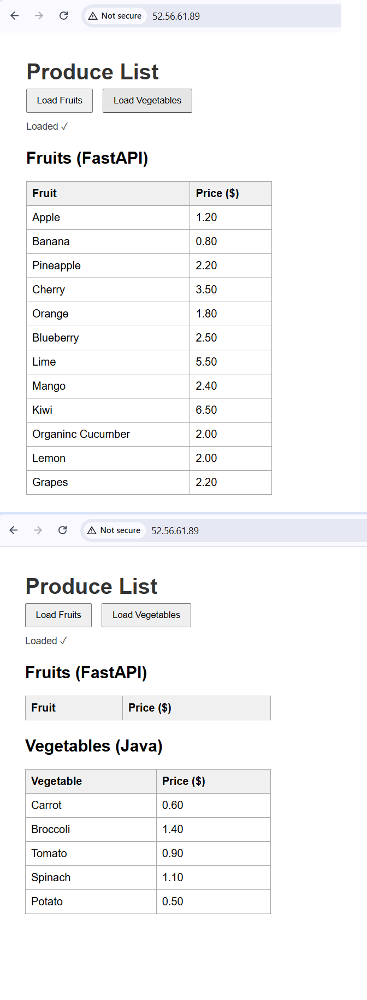

# Lab 03: Two-Tier Infrastructure on AWS

A two-tier web application deployed on AWS EC2 across two Availability Zones, with launch templates for repeatable node creation and setup scripts stored in GitHub.

## Goal

Build a two-tier infrastructure where:

- **Tier 1 (frontend):** two Nginx web servers
- **Tier 2 (backend):** two servers running Python 3 and Java 17
- Each tier has one node in each of two Availability Zones, for redundancy
- Launch templates make node creation fast and repeatable
- Setup scripts are kept in a GitHub repository

Application: a "Produce List" page. The Python (FastAPI) service returns fruits and the Java (Spring Boot) service returns vegetables.
Source repo: [jidavy/fruits-veg_market](https://github.com/jidavy/fruits-veg_market) (fork of techbleat/fruits-veg_market).

## Architecture

```
                         User (browser)
                        /               \
              +--------------- eu-west-2 / two-tier-vpc (10.0.0.0/16) ---------------+
              |   AZ eu-west-2a                       AZ eu-west-2b                    |
              |   Public subnet 10.0.0.0/20           Public subnet 10.0.16.0/20       |
              |                                                                        |
  Tier 1      |   frontend-az1 (Nginx :80)            frontend-az2 (Nginx :80)         |
              |        |                                    |                          |
  Tier 2      |   backend-az1                         backend-az2                      |
              |   Python :9000 + Java :8080           Python :9000 + Java :8080        |
              +------------------------------------------------------------------------+
```

Each frontend is configured to call the backend in its own AZ. The browser calls the backend ports directly.

## What I built

| Component | Detail |
|---|---|
| Region | eu-west-2 (London) |
| VPC | `two-tier-vpc`, 10.0.0.0/16 |
| Subnets | One public subnet per AZ (eu-west-2a, eu-west-2b), auto-assign public IPv4 on |
| Internet access | `two-tier-igw` attached, `two-tier-rtb-public` routes 0.0.0.0/0 to it |
| Frontend security group | SSH 22 (my IP only), HTTP 80 (anywhere) |
| Backend security group | SSH 22 (my IP only), TCP 9000 and 8080 (anywhere) |
| AMI | Amazon Linux 2023 |
| Backend nodes | `backend-template`, t3.small, 2 instances (one per AZ) |
| Frontend nodes | `frontend-template`, t3.micro, 2 instances (one per AZ) |

## Scripts

Both scripts are in [`scripts/`](scripts/) and are pasted into the **User data** of each launch template, so a new node configures itself on first boot.

- [`backend-setup.sh`](scripts/backend-setup.sh): installs Git, Python 3, Java 17 (Corretto) and Maven, clones the repo, starts the FastAPI app on port 9000 and the Spring Boot app on port 8080.
- [`frontend-setup.sh`](scripts/frontend-setup.sh): installs Nginx and Git, clones the repo, copies `index.html` to the web root and replaces the backend placeholders with the backend's IP.

The frontend template holds a placeholder for the backend address. At launch I edited it so each frontend points at the backend in its own AZ.

## Steps

1. Created a dedicated VPC with two public subnets (one per AZ), an internet gateway and a route table.
2. Created the frontend and backend security groups inside that VPC.
3. Wrote the two setup scripts and pushed them to GitHub.
4. Created `backend-template` and launched one backend in each AZ by choosing the subnet at launch.
5. Tested each backend directly on ports 9000 and 8080.
6. Created `frontend-template` and launched one frontend in each AZ, setting the backend IP at launch.
7. Opened both frontends in the browser and loaded fruits and vegetables.

## Verification

**Network**



**Security group rules**



**Launch templates**



**Four instances across two AZs**



**Backend endpoints** (`:9000/fruits` and `:8080/vegetables`, tested on both backend nodes)



**Frontend in AZ1**



**Frontend in AZ2**



## Design choices

- **Two AZs per tier:** if one AZ fails, one node of each tier is still running.
- **Launch templates:** every node is built from the same script, so nodes are identical and quick to replace.
- **Dedicated VPC:** keeps the lab isolated from the default VPC and shows the full network path (subnet, route table, internet gateway).
- **Scripts in Git:** the setup is versioned and reviewable, not clicked together by hand.
- **Nginx for the web tier:** the brief mentioned Apache/HTTPD, but I chose Nginx because it is what I used in class and the app supports either.
- **SSH locked to my IP:** only the app ports are open to the world.

## Problems I hit and how I fixed them

- **Backend security group had the wrong port.** I first opened only 9000. The page needs two services, so I read the repo's `index.html` and added 8080 for the Java vegetables API.
- **Security groups were in the wrong VPC.** Groups belong to one VPC, so the ones I made in the default VPC could not be used in `two-tier-vpc`. I recreated them there with "Copy to new security group".
- **Launch template had no AMI.** I saved a new template version with Amazon Linux 2023 and set it as the default.
- **Two groups with the same name.** I checked the security group ID rather than the name when attaching to the template.
- **A Git repo inside another Git repo.** I had cloned the app repo inside this portfolio, so I moved it out to avoid an embedded-repository mess.

## Limitations and next steps

- The backend ports 9000 and 8080 are open to the internet because the browser calls them directly. A better design puts a reverse proxy on the frontend so the backend can sit in private subnets with ports open only to the frontend.
- Public IPs change when instances are stopped and started. Elastic IPs or a load balancer would fix this.
- The apps are started with `nohup`, so they do not survive a reboot. The repo includes a `fruits.service` systemd unit I could use for that.
- Add an Application Load Balancer in front of the two frontends to spread traffic and remove the single user-facing IP.

## What I learned

- A launch template can serve several AZs because the subnet is chosen at launch.
- A passed instance status check only means the VM is up. The application can still be installing.
- Security groups, subnets and route tables all have to line up before a page will load.
