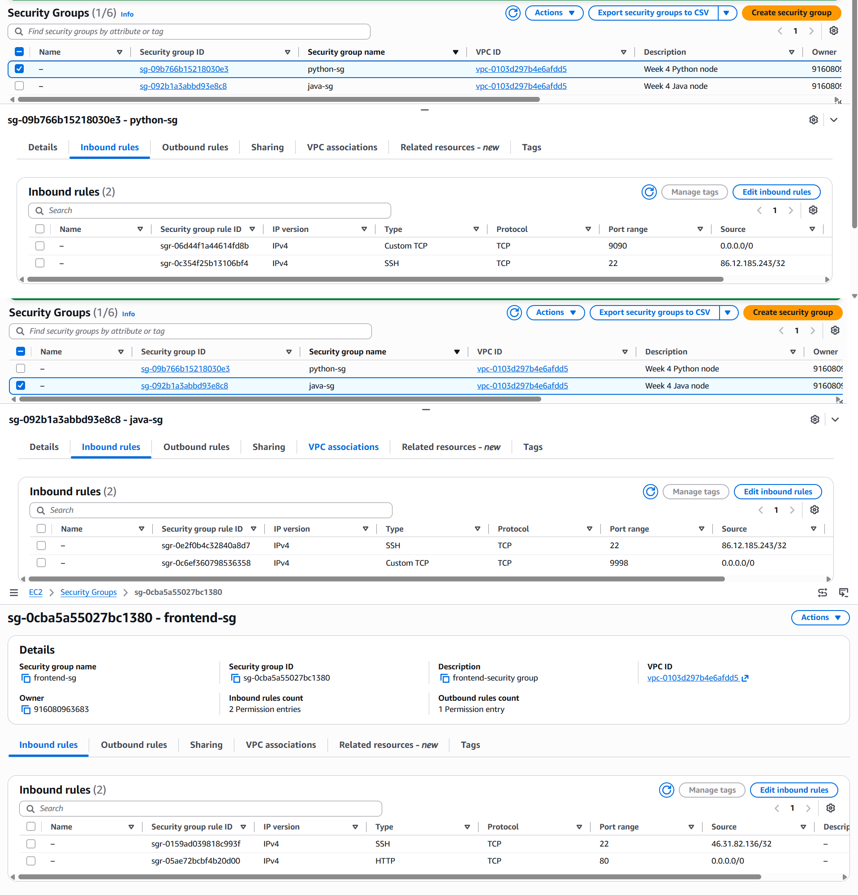
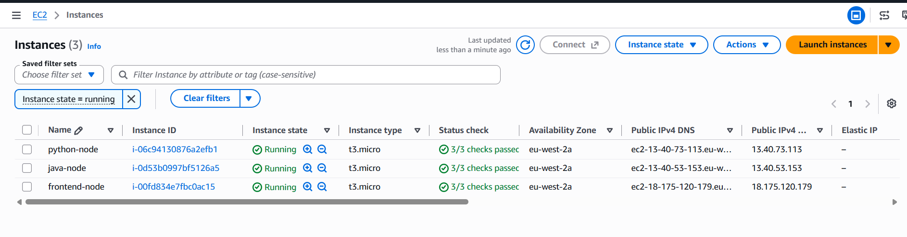
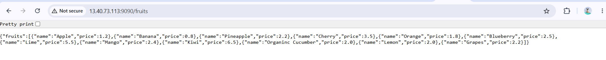
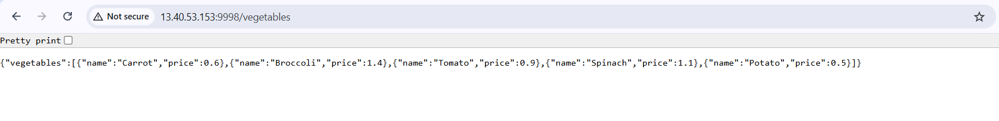
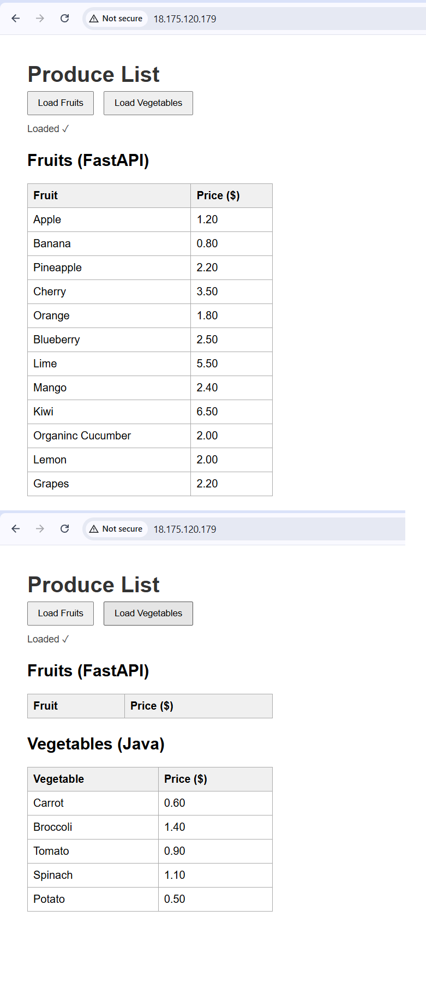

# Lab 04: Two-Tier Deployment on Three Separate Nodes

A two-tier web application deployed on three AWS EC2 nodes: an Nginx frontend, a Python backend on port 9090 and a Java backend on port 9998. Each node is built from a setup script stored in GitHub.

## Goal

Replicate the class deployment using three nodes:

- **Node 1 (Tier 1, frontend):** Nginx serving the web page
- **Node 2 (Tier 2, backend):** Python 3 service on port **9090**
- **Node 3 (Tier 2, backend):** Java 17 service on port **9998**

Application: a "Produce List" page. The Python (FastAPI) service returns fruits and the Java (Spring Boot) service returns vegetables.
Source repo: [jidavy/fruits-veg_market](https://github.com/jidavy/fruits-veg_market) (fork of techbleat/fruits-veg_market).

## Architecture

```
                 User (browser)
                       |
                  :80  v
              +---------------+
              | frontend-node |   Nginx
              +---------------+
                 |           |
          :9090  v           v  :9998
     +-------------+     +-------------+
     | python-node |     |  java-node  |
     | FastAPI     |     | Spring Boot |
     +-------------+     +-------------+

     All three nodes: eu-west-2a, public subnet of two-tier-vpc
```

The browser loads the page from the frontend and then calls each backend directly.

## What I built

| Component | Detail |
|---|---|
| Region / AZ | eu-west-2 (London), eu-west-2a |
| Network | `two-tier-vpc` and public subnet from [Lab 03](../03-two-tier-infrastructure/) |
| AMI | Amazon Linux 2023 |
| Instance type | t3.micro (all three nodes) |
| `frontend-node` | Nginx, `frontend-sg`: SSH 22 (my IP only), HTTP 80 (anywhere) |
| `python-node` | Python 3 + FastAPI, `python-sg`: SSH 22 (my IP only), TCP 9090 (anywhere) |
| `java-node` | Java 17 (Corretto) + Spring Boot, `java-sg`: SSH 22 (my IP only), TCP 9998 (anywhere) |

Each node has its own security group, so only the port that node needs is open.

## Scripts

Each script is in [`scripts/`](scripts/) and was pasted into the **User data** of its instance, so the node configures itself on first boot.

- [`python-setup.sh`](scripts/python-setup.sh): installs Git and Python 3, clones the repo, creates a virtual environment, installs the requirements and starts the FastAPI app with `--port 9090`.
- [`java-setup.sh`](scripts/java-setup.sh): installs Git, Java 17 and Maven, clones the repo and starts the Spring Boot app with `--server.port=9998`.
- [`frontend-setup.sh`](scripts/frontend-setup.sh): installs Nginx and Git, clones the repo, copies `index.html` to the Nginx web root and rewrites the backend host and port placeholders to point at the two backend nodes.

The original `index.html` has the backend ports (9000 and 8080) written into it, so the frontend script replaces both the host and the port for each backend.

## Steps

1. Created `python-sg` and `java-sg` in the existing `two-tier-vpc`, and reused `frontend-sg`.
2. Wrote the three scripts and pushed them to GitHub.
3. Launched `python-node` and tested `:9090/fruits` directly.
4. Launched `java-node` and tested `:9998/vegetables` directly.
5. Launched `frontend-node` with both backend IPs set in its User data.
6. Opened the frontend in the browser and loaded fruits and vegetables.

I tested each backend on its own before building the frontend, so that a failure on the page could only come from the frontend configuration.

## Verification

**Security group rules**



**Three nodes running**



**Python backend on port 9090**



**Java backend on port 9998**



**Frontend loading data from both backends**



## Design choices

- **One node per service:** Python and Java can be changed, restarted or scaled on their own, and a problem in one does not affect the other.
- **One security group per node:** each node only exposes its own port, plus SSH from my IP.
- **Scripts in Git and in User data:** the setup is repeatable and reviewable, not clicked together by hand.
- **Backends tested before the frontend:** found problems in one place at a time.
- **Nginx for the web tier:** as the brief asked.

## Notes

- The repo includes a `fruits.service` systemd unit with port 9000. My script starts the app directly with `--port 9090`, so that file is not used and the port on the command line wins.
- Java built and ran fine on a t3.micro, but the first start is slow because Maven downloads its dependencies.

## Limitations and next steps

- All three nodes are in one AZ, so an AZ failure takes everything down. [Lab 03](../03-two-tier-infrastructure/) shows the same application spread across two AZs, and the same approach could be applied here.
- The apps are started with `nohup`, so they do not survive a reboot. Using systemd units would fix that.
- The backend ports are open to the internet because the browser calls them directly. A reverse proxy on the frontend would let the backends accept traffic only from it.
- Public IPs change if instances are stopped and started, so the frontend would need updating. Elastic IPs or a load balancer would fix this.

## What I learned

- Port numbers set on a command line override the ones in a service file that is never started.
- A hard-coded value in front-end code (here the backend ports) has to be changed along with the server settings.
- Testing each tier on its own makes the full deployment much easier to debug.
