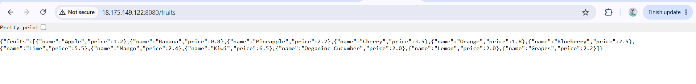
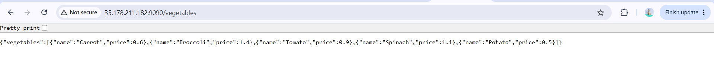
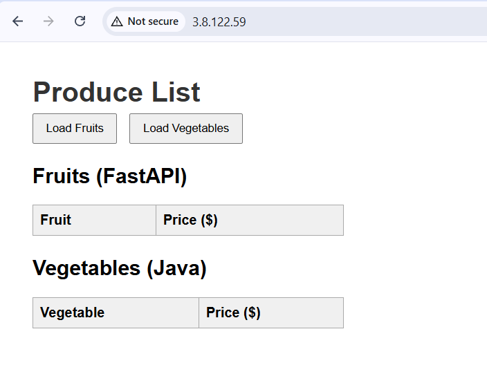
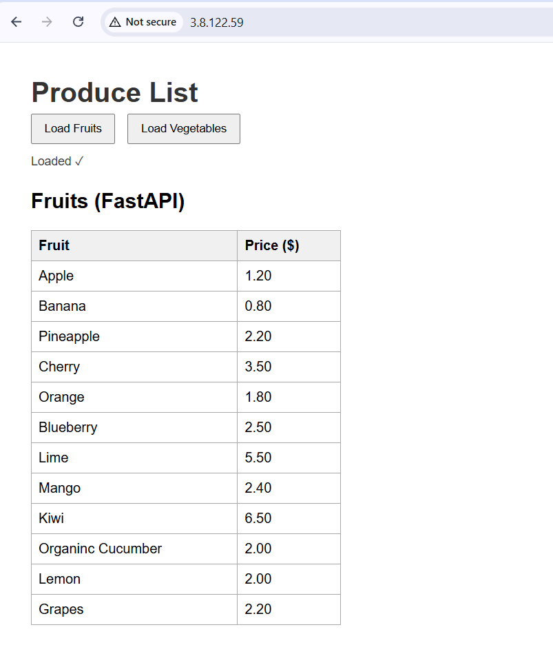
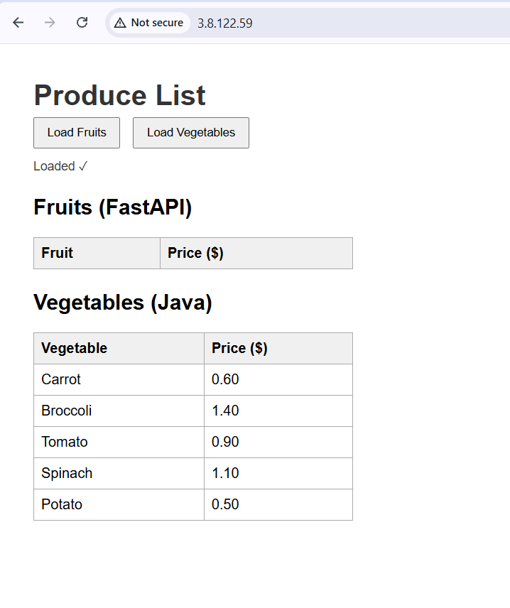

# Lab 05 (v2): Two-Tier Infrastructure with Packer and Terraform

Rebuilt the Week 4 three-node deployment as code. **Packer** bakes two AMIs, and **Terraform** launches three servers from them.

## Architecture

| Node | AMI | Role | Port |
|---|---|---|---|
| 1 | fruits-nginx | Frontend: Nginx serves the web page | 80 |
| 2 | fruits-backend | Backend: Python 3 (FastAPI) | 8080 |
| 3 | fruits-backend | Backend: Java 17 (Spring Boot) | 9090 |

Nodes 2 and 3 use the same AMI (Java 17, Maven and Python 3 installed). The difference is which app Terraform starts at boot.

## How it works

### Packer (`packer/`)
- `aws-ami.pkr.hcl` defines two builds from the latest Amazon Linux 2023 image in eu-west-2.
- `scripts/nginx-setup.sh` installs Nginx and git, clones the app and copies `index.html` into place.
- `scripts/backend-setup.sh` installs Java 17, Maven and Python 3, builds the Java jar and creates the Python virtual environment.
- The scripts only install and prepare. The build machine is imaged and shut down, so nothing is started during the build.

### Terraform (`terraform/`)
- Looks up the default VPC and the existing `dev_key` key pair.
- Creates two security groups: frontend (80, 22) and backend (8080, 9090, 22).
- Launches three instances. Each gets a `user_data` script that runs at first boot:
  - Python node: starts `uvicorn` on 8080
  - Java node: starts the jar on 9090
  - Nginx node: uses `sed` to point `index.html` at the two backend public IPs, then starts Nginx
- The Nginx instance references the backend IPs, so Terraform creates the backends first.

## Run it

```bash
cd packer && packer init . && packer build .
# put the two AMI IDs into terraform/variables.tf
cd ../terraform && terraform init && terraform apply
```

Destroy with `terraform destroy`.

## Screenshots

| | |
|---|---|
| Python backend `/fruits` on 8080 |  |
| Java backend `/vegetables` on 9090 |  |
| Frontend before loading data |  |
| Frontend with fruits loaded |  |
| Frontend with vegetables loaded |  |

## What I learned

(Write 3 to 5 sentences in your own words here. Some ideas: why Packer scripts can't leave apps running, why the `sed` moved into Terraform's `user_data`, what a data source is and why I used one for `dev_key`, what mistake you hit and how you fixed it.)

## Cleanup

Resources were destroyed after testing. The `dev_key` key pair is managed outside Terraform and was left in place.
